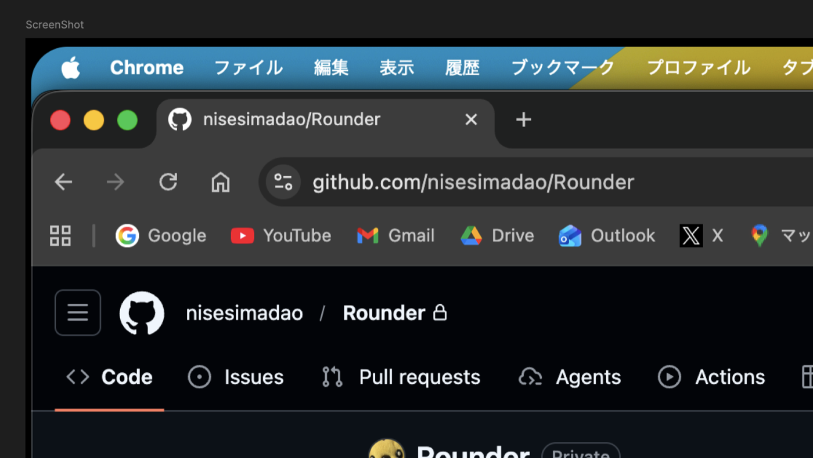
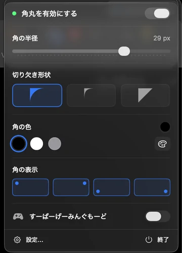
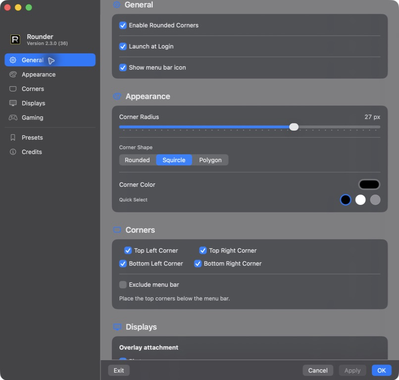
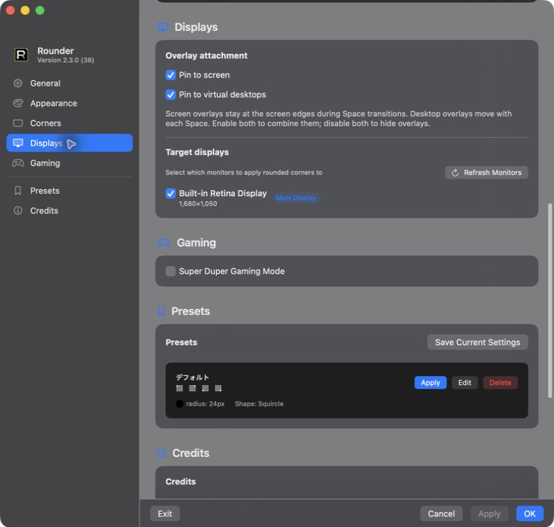

#  Rounder

Round display corners and blend a MacBook notch into a black menu bar.

[](https://github.com/nisesimadao/Rounder/releases/latest)
[](https://github.com/nisesimadao/Rounder/actions/workflows/release.yml)
[](#requirements)

<p align="center">
  
</p>

Rounder adds rounded corners to external monitors and older MacBook displays. On a MacBook with a notch, it can paint the menu bar black so the notch blends into its background, then round the top corners of the application area below it.

It runs in the menu bar, supports multiple displays, and needs no Accessibility, Screen Recording, or Automation permission. You can hide its menu-bar icon and open `Rounder.app` to return to Settings.

[日本語版 README](./README_jp.md)

## Features

- Rounded, Squircle, and Polygon corner shapes
- Corner radius from 0 to 40 px, with live menu-panel adjustment
- Any corner color, plus black, white, and gray quick swatches
- Independent switches for all four corners
- A black menu bar background for selected displays
- Top corners below the menu bar with **Exclude menu bar**
- Screen-fixed and virtual-desktop-attached overlays, usable together
- Presets that save appearance, attachment, and menu-bar settings
- Animated rainbow edges with Super Duper Gaming Mode
- Launch at Login and optional menu-bar icon visibility

## On a MacBook with a notch

In **Settings → Presets**, apply **Notched MacBook**. This uses black corners, places the top corners below the menu bar, and paints the menu bar background black. The physical notch blends into that black strip.

You can also set this up manually:

1. In **Corners**, enable **Exclude menu bar** and **Black menu bar background**.
2. In **Appearance**, set the corner color to black.
3. In **Displays**, select the built-in display and the attachment modes you want.
4. Click **Apply**.

macOS chooses the menu text color from the wallpaper. A black background can make dark text hard to read, so use a dark wallpaper if that happens. Rounder changes the background, not the system text color.

Black menu bar support and the three presets below are new in **2.4.0**.

## Built-in presets

| Preset | Fixed to screen | Attached to virtual desktops | Exclude menu bar | Black menu bar |
| --- | --- | --- | --- | --- |
| Default | On | Off | Off | Off |
| Virtual Desktops | Off | On | Off | Off |
| Notched MacBook | On | On | On | On |

All three start with black, rounded corners at a 20 px radius. You can edit them or save your own settings as another preset. Upgrading keeps user-created presets.

Screen-fixed corners stay at the physical screen edges during Space transitions. Desktop-attached corners move with each desktop. Enabling both combines them; turning both off hides the corner overlays.

With **Exclude menu bar** enabled, screen-fixed top corners move to the physical top edge in a fullscreen Space and return below the menu bar in a normal Space. In Mission Control, the black strip and top corners fade out together and return when you leave. Lower corners remain visible. These animations respect the macOS Reduce Motion setting.

## Menu-bar controls

The menu panel contains enable/disable, radius, shape, quick colors, individual corners, Gaming Mode, Settings, and Quit.



Radius and shape changes update the existing corner windows. Clicking the status icon again closes the panel; clicking outside it or pressing Escape also closes it.

## Settings

Settings includes the full color picker, display selection, presets, menu-bar options, attachment modes, and Gaming Mode speed, intensity, and bloom width. Click **Apply** to save changes.



The attachment switches are in **Displays**. Menu-bar exclusion and the black background switch are in **Corners**, below the four corner switches.



If you hide the menu-bar icon, open `Rounder.app` again to show Settings. This does not turn the icon back on. Login launches remain silent.

## Download and install

Download `Rounder.zip` from [Releases](https://github.com/nisesimadao/Rounder/releases/latest), unzip it, and move `Rounder.app` to `/Applications`.

Release builds are ad-hoc signed. They are not Developer ID signed or notarized, so macOS may block the first launch. Right-click `Rounder.app`, choose **Open**, then choose **Open** again in the confirmation dialog.

If necessary, remove the quarantine attribute manually:

```bash
xattr -dr com.apple.quarantine /Applications/Rounder.app
```

First launch walks through radius, color, and login settings. Click **Start Rounder** to run it in the background. The Dock icon appears while onboarding or Settings is open.

## Requirements

- macOS 14.6 or later
- Apple Silicon or Intel Mac

## Privacy and permissions

Rounder does not collect telemetry or analytics. It stores settings locally in macOS `UserDefaults` and needs no network access for its core functions.

It draws click-through overlay windows and reads local display, Space, and window metadata. It does not capture screen images or request Accessibility, Screen Recording, or Automation permission.

See [Privacy](./docs/PRIVACY.md) and [Security](./docs/SECURITY.md).

## Build from source

Open `Rounder.xcodeproj` in Xcode, or build from the command line:

```bash
xcodebuild -project Rounder.xcodeproj -scheme Rounder -configuration Release build
```

The app uses SwiftUI, AppKit, Core Graphics, and Core Animation. Some Space behavior uses optional private macOS APIs and may vary between macOS versions.

Pushing a `vX.Y.Z` tag runs the tests and release build, then publishes `Rounder.zip`.

## Troubleshooting

**Corners are not visible.** Enable Rounder, select the target display, and enable at least one attachment mode in Displays. On a notched MacBook, try the Notched MacBook preset to see the effect below the menu bar.

**Menu labels are hard to read.** Use a dark wallpaper or turn off Black menu bar background. macOS controls the label color.

**A setting did not take effect.** Click Apply in Settings. Radius and shape changes in the menu panel apply immediately.

**The menu-bar icon is hidden.** Open `Rounder.app`, then turn on Show menu bar icon in General.

[FAQ](./docs/FAQ.md) · [Release notes](https://github.com/nisesimadao/Rounder/releases) · [License](./LICENSE)
