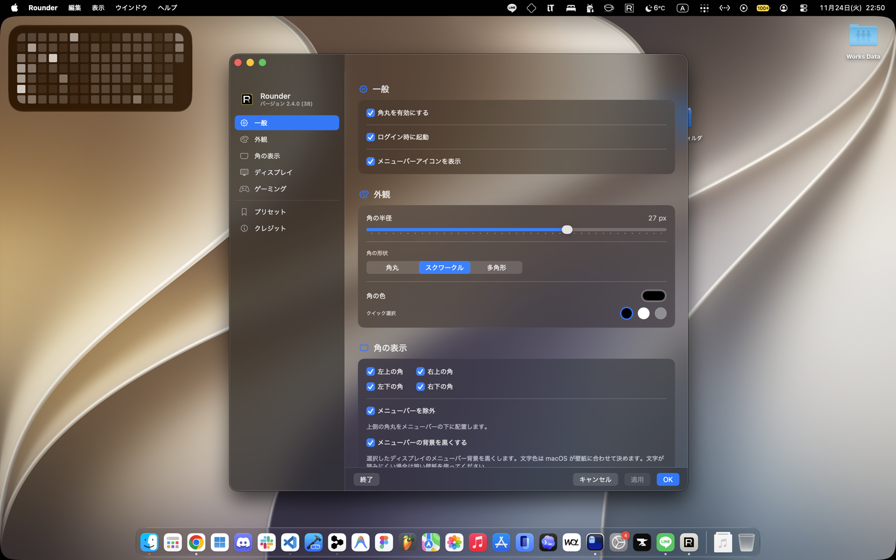
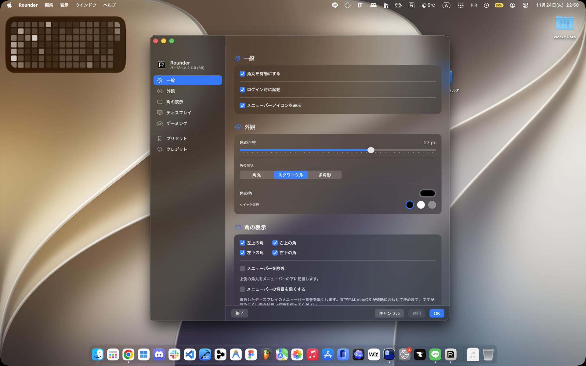
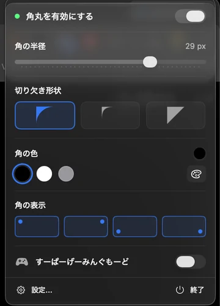
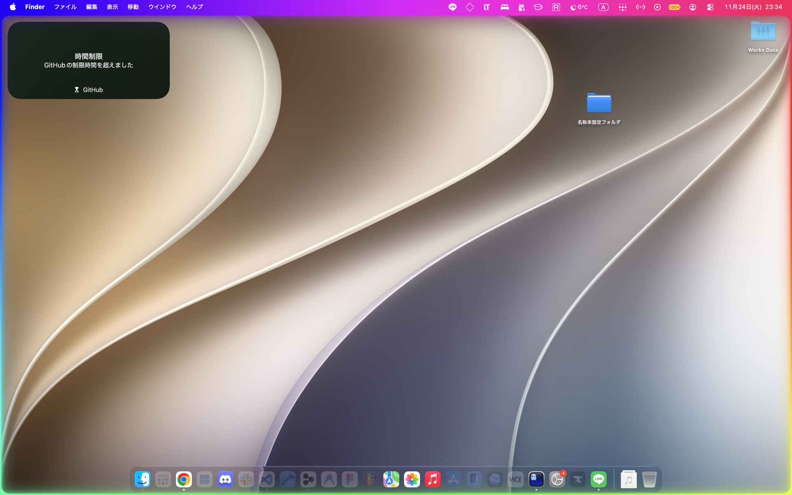
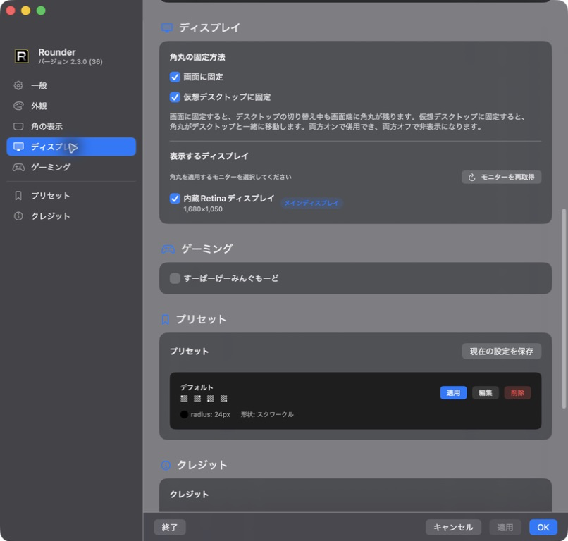

#  Rounder

画面の角を丸くし、黒いメニューバーで MacBook のノッチを目立たなくする macOS ユーティリティです。

[](https://github.com/nisesimadao/Rounder/releases/latest)
[](https://github.com/nisesimadao/Rounder/actions/workflows/release.yml)
[](#システム要件)

<p align="center">
  
</p>

<details>
  <summary>メニューバー背景をオフにした状態と比較</summary>
  <p>こちらは背景の黒塗りをオフにした状態です。角丸は有効のままです。</p>
  
</details>

Rounder は、外部モニターや古い MacBook の直線的な画面の角を丸く見せます。ノッチ搭載 MacBook では、メニューバーの背景を黒くしてノッチを目立たなくし、その下にあるアプリ領域の上端を角丸にできます。

複数のディスプレイに対応し、メニューバーに常駐します。アクセシビリティ・画面収録・自動化の権限は不要です。アイコンを隠しても動作を続け、`Rounder.app` を開き直すと設定画面へ戻れます。

[English README](./README.md)

## 主な機能

- 角丸・スクワークル・多角形の3種類の形状
- 0〜40 px の角半径と、メニューパネルからの即時調整
- 任意の角色と、黒・白・グレーのクイック選択
- 四隅の個別表示
- 選択したディスプレイのメニューバー背景を黒くする設定
- 上側の角丸をメニューバー直下に配置する「メニューバーを除外」
- 画面への固定と仮想デスクトップへの固定。それぞれ個別に有効化・併用可能
- 見た目・固定方法・メニューバー設定を保存するプリセット
- 画面の縁が虹色に光る「すーぱーげーみんぐもーど」
- ログイン時の起動と、メニューバーアイコンの表示切り替え

## ノッチ搭載 MacBook で使う

「設定 → プリセット」で **Notched MacBook** を適用すると、上側の角丸がメニューバー直下に配置され、メニューバーの背景も黒くなります。黒い帯にノッチがなじみ、その下のアプリ領域が角丸になります。

個別に設定する場合は、次の手順で変更します。

1. 「角の表示」で「メニューバーを除外」と「メニューバーの背景を黒くする」をオンにする。
2. 「外観」で角の色を黒にする。
3. 「ディスプレイ」で内蔵ディスプレイと固定方法を選ぶ。
4. 「適用」を押す。

メニューの文字色は macOS が壁紙の明るさに合わせて決めます。黒い背景で文字が読みにくくなる場合は、暗い壁紙を使ってください。Rounder が変更するのは背景で、システムの文字色は変更しません。

黒いメニューバーと、以下の3つの初期プリセットは **2.4.0** で追加しました。

## 初期プリセット

| プリセット | 画面に固定 | 仮想デスクトップに固定 | メニューバーを除外 | 背景を黒くする |
| --- | --- | --- | --- | --- |
| Default | オン | オフ | オフ | オフ |
| Virtual Desktops | オフ | オン | オフ | オフ |
| Notched MacBook | オン | オン | オン | オン |

3つとも、黒・角丸形状・半径20 px が初期値です。編集したり、現在の設定を別のプリセットとして保存したりできます。アップデート時もユーザーが作成したプリセットは残します。

「画面に固定」は、Space の切り替え中も物理的な画面端に角丸を残します。「仮想デスクトップに固定」は、角丸がデスクトップと一緒に移動します。両方オンで併用し、両方オフで角丸を非表示にします。

「メニューバーを除外」がオンの場合、画面固定の上の角丸はフルスクリーンの Space で画面上端へ移動し、通常の Space ではメニューバー直下へ戻ります。Mission Control 中は黒い帯と上の角丸が一緒にフェードして隠れ、終了すると戻ります。下の角丸は残ります。macOS の「視差効果を減らす」が有効な場合は、アニメーションせず切り替えます。

## メニューバーからの操作

メニューパネルでは、有効・無効、角半径、形状、クイック色、四隅の表示、すーぱーげーみんぐもーど、設定、終了を操作できます。



**2.4.1** では、メニューバーの帯も上の角丸・発光と同じ色と速度で変化します。帯の明るい色は、白い文字を読みやすくするために暗く補正します。帯専用の速度や色の設定はありません。通常モードのメニューバー背景には、角丸で選んだ色を使います。

<p align="center">
  
</p>

半径と形状は既存の切り欠きウィンドウをその場で更新します。アイコンの再クリック、パネル外のクリック、Esc キーでパネルを閉じられます。

## 設定

設定画面では、フルカラーピッカー、対象ディスプレイ、プリセット、メニューバー設定、固定方法、発光の速度・強度・Bloom 幅を変更できます。変更後は「適用」を押してください。

固定方法は「ディスプレイ」に、メニューバーの除外と背景の黒塗りは「角の表示」の四隅のスイッチの下にあります。



アイコンを非表示にしていても、`Rounder.app` を開き直すと設定画面を表示します。設定を開いただけではアイコンを再表示しません。ログイン時の自動起動では設定画面を開きません。

## ダウンロードとインストール

[Releases](https://github.com/nisesimadao/Rounder/releases/latest) から `Rounder.zip` をダウンロードし、解凍した `Rounder.app` を `/Applications` に移動します。

リリース版は ad-hoc 署名ですが、Developer ID 署名と公証は行っていません。macOS が初回起動を止める場合は、`Rounder.app` を右クリックして「開く」を選び、確認画面でもう一度「開く」を選択してください。

必要な場合は、quarantine 属性を手動で削除できます。

```bash
xattr -dr com.apple.quarantine /Applications/Rounder.app
```

初回起動では、半径・色・ログイン時の起動を設定します。「Rounder を開始」を押すとバックグラウンドで動作します。Dock アイコンは初期設定中と設定画面を開いている間だけ表示します。

## システム要件

- macOS 14.6 以降
- Apple Silicon または Intel Mac

## プライバシーと権限

テレメトリや分析データは収集しません。設定は macOS の `UserDefaults` に保存し、主要機能にネットワークアクセスは必要ありません。

クリックを透過するウィンドウを描画し、ローカルのディスプレイ・Space・ウィンドウのメタデータを読み取ります。画面の画像は取得せず、アクセシビリティ・画面収録・自動化の権限も要求しません。

詳しくは [Privacy](./docs/PRIVACY.md) と [Security](./docs/SECURITY.md) を参照してください。

## ソースからビルド

Xcode で `Rounder.xcodeproj` を開くか、次のコマンドでビルドします。

```bash
xcodebuild -project Rounder.xcodeproj -scheme Rounder -configuration Release build
```

SwiftUI・AppKit・Core Graphics・Core Animation を使っています。Space 関連の一部の動作には macOS の非公開 API を使うため、OS のバージョンによって挙動が変わることがあります。

`vX.Y.Z` タグを push すると、テストと Release ビルドの後に `Rounder.zip` を公開します。

## トラブルシューティング

**角丸が表示されない場合。** Rounder を有効にし、対象ディスプレイと固定方法を一つ以上選んでください。ノッチ搭載 MacBook では、Notched MacBook プリセットを適用するとメニューバー直下の変化を確認できます。

**メニューの文字が読みにくい場合。** 暗い壁紙に変えるか、メニューバー背景の黒塗りをオフにしてください。文字色は macOS が決めます。

**設定が反映されない場合。** 設定画面では「適用」を押してください。メニューパネルの半径と形状は即時に反映します。

**メニューバーアイコンが見つからない場合。** `Rounder.app` を開き、「一般」で「メニューバーアイコンを表示」をオンにしてください。

[FAQ](./docs/FAQ.ja.md) · [リリースノート](https://github.com/nisesimadao/Rounder/releases) · [ライセンス](./LICENSE)
